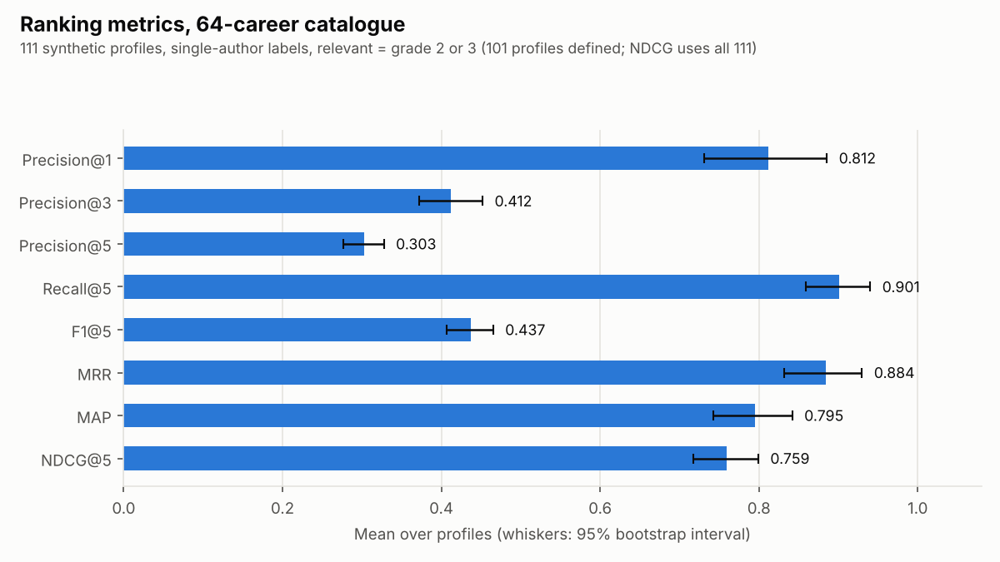
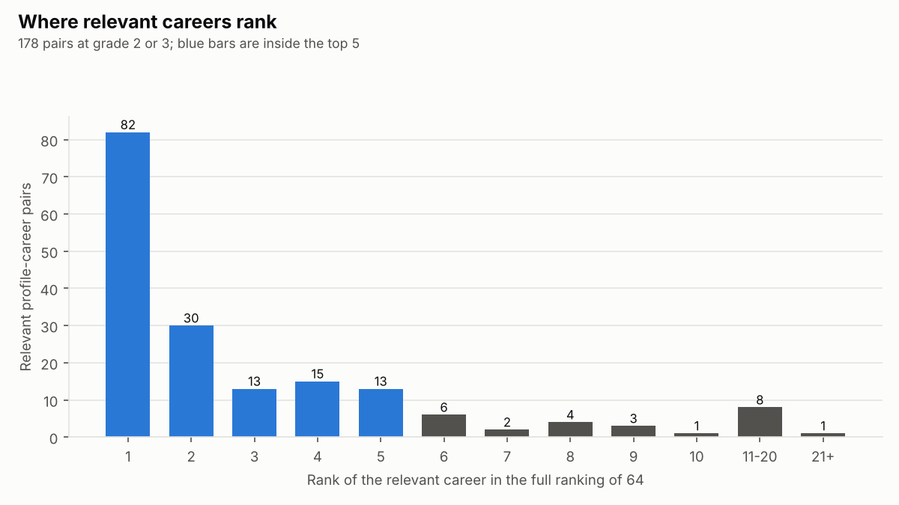
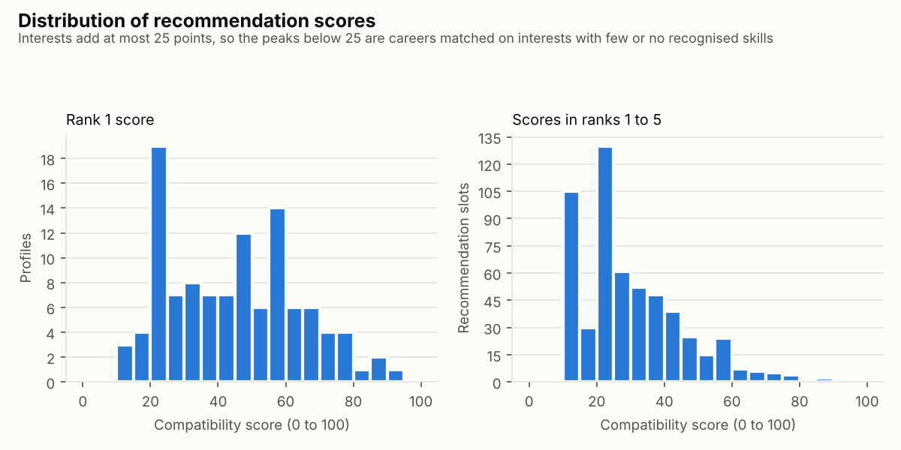
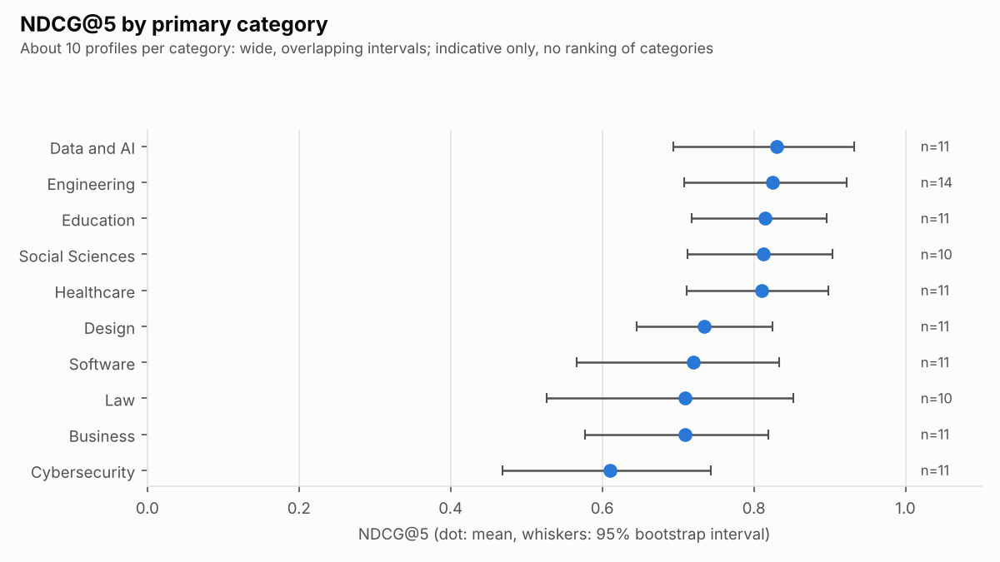
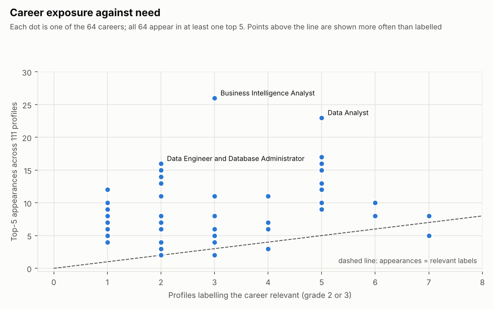
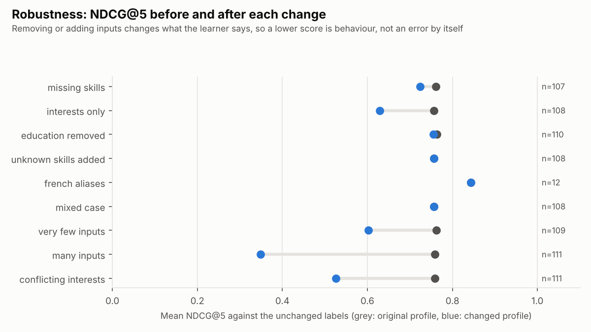
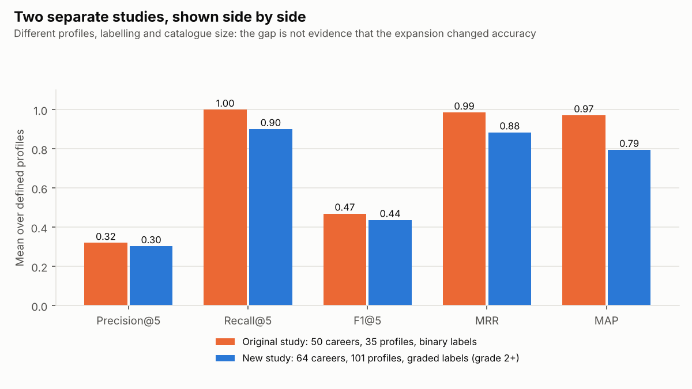

# Independent 64-career evaluation: technical report (eval64_v1)

Run on 1 November 2026 from commit 09232f8 plus the uncommitted evaluation files. Outputs: `reports/evaluation_64/`. Method: `docs/independent_64_evaluation_methodology.md`. Risks: `docs/independent_64_evaluation_risks.md`.

## 1. Executive summary

- The unchanged engine was run on 111 new synthetic profiles. Its rankings were compared with 363 graded labels that were written and frozen before the first run.
- With grade 2 or higher counted as relevant, 101 profiles have at least one relevant career:
  - Every one of them has a relevant career in its top 5 (Hit@5 = 1.0).
  - The first result is relevant for 81% of them (Precision@1 = 0.812).
  - On average, 90% of their relevant careers are in the top 5 (Recall@5 = 0.901).
- Graded NDCG@5 over all 111 profiles is 0.759, 95% interval [0.717, 0.799].
- All 64 careers and all 10 categories have labels, and every career appears in at least one top 5.
- **The largest weakness is vocabulary.** 269 of the 480 skill entries typed in the profiles (56.0%) are not recognised. 22 of the 108 profiles that list skills have none recognised, and they are ranked on interests and education alone.
- **Exposure:** Data and AI careers take 22.7% of all top-5 slots, against 9.9% of the profiles.
  - Common interests let low-scoring careers into the top 5 with no matched skill.
  - The career-ID tie-break then favours the lowest IDs (C001 to C008). 65 of the 126 Data and AI slots were decided inside a career-ID tie.
  - The exploratory sensitivity analysis (section 17) confirms the tie-break as the main driver: without it, Data and AI slots fall to about 81 to 83 (about 15%).
  - Interest-list length is not a material cause. An earlier version of this report listed it as one, and that statement is withdrawn.
- **Ties:** 62 of 111 profiles have a tie at ranks 5 and 6. Every one of them is decided by career ID, because the engine's earlier tie-break keys never separate them. Across all profiles, 139 of 555 top-5 slots (25.0%) are decided this way. 10 relevant careers (all original) lose their top-5 place to an equal-scoring career with a lower ID. No new career ever ranks ahead of an original one on a tie.
- Adding ten common skills (Python, SQL and others) moves the top recommendation for 79% of profiles.
- Section 16 reports the review tasks of 2 November 2026 (vocabulary, profile types, exposure, ties, second review). Those diagnostics were added after the first results and are reported as such.
- **What these results are:** agreement with labels written by one AI labeller who also built part of the catalogue, on synthetic profiles. They are **not** real-world accuracy, employment outcomes or proof of suitability for any profession. No second reviewer has checked the labels, and no agreement statistic exists.

## 2. Objectives

1. Measure how well the engine ranks careers judged relevant by documented occupational rules, on the 64-career catalogue.
2. Check coverage of all careers and categories, and look for exposure, education and vocabulary effects.
3. Test robustness to changed inputs, without changing the formula.
4. Keep the original 50-career study untouched and report the two studies separately.

## 3. Data

| Item | Value |
|---|---|
| Catalogue | v1.3.0, 64 careers, 10 categories, 144 skills (byte copy in `data/evaluation/catalog_v1.3.0/`, identical to `data/raw/` at run time) |
| Profiles | 111 (`profiles.csv`) |
| Explicit labels | 363: grade 3 = 79, grade 2 = 99, grade 1 = 175, grade 0 = 10. Every unlisted pair is grade 0 (rule R8) |
| Relevant pairs (grade 2 or 3) | 178 |
| Profiles without a relevant career | 10 (excluded from binary metrics only) |
| Labeller | Claude (AI assistant), single labeller |
| Frozen | SHA-256 values in `evaluation_manifest.json`; the run refuses a modified file |

Profiles by primary category: Engineering 14; Data and AI, Software, Cybersecurity, Design, Business, Education and Healthcare 11 each; Law and Social Sciences 10 each.

Profiles by type:

| Type | Profiles |
|---|---|
| strong_match | 61 |
| french_vocabulary | 10 |
| career_change | 9 |
| lower_education | 8 |
| mixed_interests | 6 |
| incomplete_skills | 4 |
| transferable_skills | 4 |
| interests_only | 3 |
| unfamiliar_vocabulary | 2 |
| no_clear_fit | 2 |
| minimal_input | 1 |
| many_inputs | 1 |

Learner stages range from beginner to professional. Education runs from level 1 to 4, and one profile leaves it blank.

## 4. Profile design

- Each category has at least 10 profiles.
- For each category, profiles were written for its typical careers first, then for its hard cases: a career change, a lower education level, French vocabulary, unclear goals.
- Coverage of all 64 careers was checked against the labels only, with no engine involvement. Every career has at least one grade-2 or grade-3 label.
- Coverage is uneven:
  - 15 careers have exactly one relevant label, and 35 careers have fewer than 3. Per-career results for these are not interpreted.
  - 29 careers have 3 or more relevant labels.
- Skills were written as a learner would type them ("Spring Boot", "Power BI", "routing and switching", "soins infirmiers"), not copied from the catalogue. This is the main reason so many skills go unrecognised.
- Weakness: 61 of 111 profiles are strong matches, so the hard cases carry less weight in the overall means than they would in a balanced set.

## 5. Labelling

- The scale (0 to 3) and rules R1 to R9 were fixed in the methodology document before any label was written.
- Each label states:
  - a justification based on the occupation's central work;
  - the O*NET code from `careers.csv`, or a note that the career has none;
  - the reviewer;
  - a confidence level.
- No label was created, removed or changed after the engine was first run.
- Main binary threshold: grade 2 or higher counts as relevant. Results at the other thresholds are in section 7.
- **Second reviewer:**
  - `review/second_reviewer_sheet.csv` holds 585 shuffled pairs with no grades: the 363 labelled pairs plus 2 random unlabelled careers per profile.
  - `python -m src.evaluation.eval64_review_analysis <completed sheet> --confirm-independent-reviewer` computes the design-based agreement statistics once a real reviewer fills the sheet in (section 16.5).
  - No reviewer has done so, so no agreement value is reported.

## 6. Metrics

Definitions are in the methodology document, section 5:
- Precision@k counts the hits in the top k and divides by k.
- Recall@5 divides those hits by the number of relevant careers.
- MRR and MAP use the full ranking of 64 careers.
- NDCG@5 uses the grades (0 to 3) as gains.

All means are macro averages over the profiles where the metric is defined.

## 7. Overall results

| Metric | Mean | 95% interval | Profiles |
|---|---|---|---|
| Precision@1 | 0.812 | [0.731, 0.886] | 101 |
| Precision@3 | 0.413 | [0.372, 0.452] | 101 |
| Precision@5 | 0.303 | [0.277, 0.328] | 101 |
| Recall@5 | 0.901 | [0.859, 0.940] | 101 |
| F1@5 | 0.437 | [0.407, 0.465] | 101 |
| Hit@5 | 1.000 | [1.000, 1.000] | 101 |
| MRR | 0.884 | [0.831, 0.930] | 101 |
| MAP | 0.795 | [0.743, 0.842] | 101 |
| NDCG@5 | 0.759 | [0.717, 0.799] | 111 |

**Reading it:**
- Precision@5 is low by construction. Profiles have 1.76 relevant careers on average (178 relevant pairs over 101 profiles), so a perfect top 5 would score 0.350. The observed 0.303 is 87% of that maximum.
- Precision@1 and MRR show that the first relevant career is usually at rank 1. Of the 178 relevant pairs, 82 rank first, 153 (86%) are in the top 5, and the median rank is 2.

**Threshold sensitivity** (`threshold_sensitivity.csv`):

| Threshold | Profiles defined | Precision@5 | Recall@5 | Hit@5 | MRR | MAP |
|---|---|---|---|---|---|---|
| grade 2 or higher (main) | 101 | 0.303 | 0.901 | 1.000 | 0.884 | 0.795 |
| grade 1 or higher | 111 | 0.432 | 0.692 | 0.991 | 0.914 | 0.678 |
| grade 3 only | 78 | 0.195 | 0.962 | 0.962 | 0.878 | 0.874 |

Counting weak links (grade 1) as relevant lowers recall, because many weak careers are not in the top 5. Counting only strong links leaves 78 profiles. For 3 of them (3.8%), the grade-3 career is outside the top 5.

**Scores** (top-5 scores, 0 to 100):
- Rank 1: mean 43.9, median 45.0.
- Ranks 1 to 5: mean 29.8, median 27.1.

Interests add at most 25 points, so the clusters below 25 are careers matched on interests with few or no recognised skills.

## 8. Results by category

| Category | Profiles (defined) | Careers | P@1 | P@5 | R@5 | MAP | NDCG@5 [95% interval] | Share of top-5 slots |
|---|---|---|---|---|---|---|---|---|
| Data and AI | 11 (10) | 8 | 0.900 | 0.500 | 0.967 | 0.892 | 0.830 [0.694, 0.933] | 22.7% |
| Software | 11 (11) | 8 | 0.727 | 0.418 | 0.833 | 0.696 | 0.720 [0.566, 0.834] | 10.6% |
| Cybersecurity | 11 (10) | 6 | 0.700 | 0.280 | 0.667 | 0.602 | 0.610 [0.469, 0.744] | 7.6% |
| Design | 11 (10) | 5 | 0.700 | 0.240 | 0.900 | 0.737 | 0.735 [0.646, 0.824] | 9.2% |
| Business | 11 (10) | 10 | 0.800 | 0.320 | 0.800 | 0.697 | 0.709 [0.577, 0.819] | 14.4% |
| Education | 11 (10) | 5 | 0.700 | 0.220 | 1.000 | 0.833 | 0.815 [0.718, 0.896] | 7.0% |
| Healthcare | 11 (10) | 7 | 0.800 | 0.220 | 1.000 | 0.850 | 0.810 [0.712, 0.899] | 9.2% |
| Engineering | 14 (13) | 11 | 0.923 | 0.277 | 0.923 | 0.867 | 0.824 [0.708, 0.923] | 10.6% |
| Law | 10 (8) | 2 | 0.875 | 0.250 | 1.000 | 0.885 | 0.709 [0.527, 0.852] | 3.8% |
| Social Sciences | 10 (9) | 2 | 1.000 | 0.289 | 0.944 | 0.908 | 0.812 [0.713, 0.904] | 4.9% |

- Each category has about 10 profiles, so the intervals are wide and overlap. They do not support ranking the categories.
- Cybersecurity has the lowest point estimate. Its profiles use network vocabulary ("routing and switching", "Cisco", "pare-feu") that the catalogue does not recognise.
- Data and AI profiles score well partly because the data careers share the most common skills (Python, SQL, statistics).
- The "share of top-5 slots" column counts all profiles, not only that category's. Data and AI careers fill 22.7% of slots, against 10% of profiles and 12.5% of careers.

Results for all 12 profile types, with sample-size status, are in section 16.2.

## 9. Career coverage

| Measure | Value |
|---|---|
| Careers with a relevant label | 64 of 64 |
| Categories with a relevant label | 10 of 10 |
| Careers in at least one top 5 | 64 of 64 (coverage 1.0) |
| Careers never in a top 5 | 0 (0%) |
| Profiles with a relevant career in the top 5 | 101 of 101 defined (100%) |

**Most exposed** (top-5 appearances against relevant labels):

| Career | Top-5 appearances | Relevant labels |
|---|---|---|
| Business Intelligence Analyst | 26 | 3 |
| Data Analyst | 23 | 5 |
| Sociologist | 17 | 5 |
| Data Engineer | 16 | 2 |
| Database Administrator | 16 | 2 |

**Least exposed:**
- Information Security Engineer and Instructional Designer: 2 appearances each.
- Business Administration Specialist and Digital Marketing Specialist: 3 each.

Per-career recall at 5 is reported in `career_coverage.csv` only for careers with 3 or more relevant labels. The lowest are:

| Career | Recall@5 | Relevant labels |
|---|---|---|
| Civil Engineer | 0.33 | 3 |
| Information Security Engineer | 0.33 | 3 |
| Business Administration Specialist | 0.50 | 4 |
| Information Security Analyst | 0.57 | 7 |

These are small counts.

The 14 careers added in v1.3.0 appear in 3 to 17 top-5 lists each. All 14 reach the top 5 for at least one profile that needs them.

## 10. Bias and error analysis

All figures come from `bias_analysis.csv`. They are descriptive and come with no significance tests.

1. **Vocabulary** (full breakdown in section 16.1).
   - 269 of 480 skill entries (56.0%) are not recognised.
   - The French-vocabulary profiles reach 70.0% (28 of 40 entries), and the two "unfamiliar vocabulary" profiles 75.0% (6 of 8).
   - 22 profiles have no recognised skill at all and are ranked only on interests and education.
   - This is the main cause of the weakest results:
     - Network architect (E64-Y05): 5 of 5 skills unknown.
     - Computer science student (E64-S09): C++ and algorithms unknown.
     - French security analyst (E64-Y10).
     - MIAGE student (E64-B08).
2. **Skill overlap.**
   - Across careers, the number of other careers that share a skill does not track top-5 appearances (Spearman rho 0.01).
   - Data and AI careers are over-exposed (22.7% of slots). Section 16.3 shows this comes mainly from interests and the career-ID tie-break rather than skill overlap. 55 of their 126 slots have no matched skill at all.
3. **Education.**
   - When the learner's education is below the career's usual entry level, relevant careers rank no worse: mean rank 3.05 and 91% in the top 5, over 22 pairs. When the learner meets the level: mean rank 3.26 and 85%, over 156 pairs.
   - With a weight of 0.05, education rarely decides a ranking. That fits rule R5 but means the engine does not warn learners about entry requirements through the ranking.
4. **New careers.**
   - 42 of 45 relevant pairs (93%) for the 14 new careers are in the top 5, against 83% for the original 50.
   - The new careers do not get fewer recommendations here. They have their own specific skills, and those skills came with French aliases.
   - This is not evidence that the new careers are better served in general. The profiles for them were written by the same author who wrote their skill lists (see the risks report).
5. **Ties** (full analysis in section 16.4).
   - 62 of 111 profiles have a tie at ranks 5 and 6, and 84 have a tie inside the top 5.
   - The engine sorts by total score, then required-skill coverage, then number of matched required skills, then career ID. All 62 rank-5 ties are decided by the last key, career ID.
6. **Empty and unknown input.** An empty profile and a profile with only unknown skills both get a maximum score of 0, so neither receives a perfect score.

## 11. Robustness

Production formula, deterministic runs with no random component. Each condition changes the frozen profiles as described; labels are unchanged.

| # | Condition | Profiles | Top-5 overlap (Jaccard) | Top 1 unchanged | Mean rank change of grade-3 careers | NDCG@5 before → after |
|---|---|---|---|---|---|---|
| 1 | Half the skills removed | 107 | 0.83 | 84% | +0.27 | 0.762 → 0.724 |
| 2 | Interests only | 108 | 0.69 | 59% | +1.16 | 0.757 → 0.629 |
| 3 | Education removed | 110 | 0.94 | 98% | +0.04 | 0.764 → 0.755 |
| 4 | Two unknown skills added | 108 | 1.00 | 100% | 0 | 0.757 → 0.757 |
| 5 | English skills replaced by French aliases | 12 | 1.00 | 100% | 0 | 0.843 → 0.843 |
| 6 | Mixed case | 108 | 1.00 | 100% | 0 | 0.757 → 0.757 |
| 7 | Transferable-skill and career-change profiles (as labelled) | 13 | not applicable | not applicable | not applicable | NDCG@5 0.685 |
| 8 | One skill and one interest | 109 | 0.39 | 58% | +1.41 | 0.762 → 0.603 |
| 9 | Ten common skills added | 111 | 0.23 | 21% | +4.23 | 0.759 → 0.348 |
| 10 | Interests from a distant field | 111 | 0.35 | 62% | +4.23 | 0.759 → 0.526 |

- Input handling is robust. Case, unknown words and the French aliases change nothing, which is what the design intends.
- The engine depends on interests: removing skills costs less than replacing interests (conditions 2 and 10).
- Condition 9 shows the formula's sensitivity to claimed skills. Learners who list many common skills are pulled toward data and software careers.
- Conditions 9 and 10 have the same mean rank change by coincidence: both sum to 334 over 79 pairs, with different distributions (largest changes 33 and 58).
- These changes alter what the learner says, so a lower NDCG@5 is behaviour, not an error in itself.

## 12. Comparison with the original evaluation

| Metric | Original study (50 careers) | New study (64 careers) |
|---|---|---|
| Profiles defined | 35 of 36 | 101 of 111 |
| Labels | binary, at most 3 relevant per profile, 42 careers labelled | graded 0 to 3, 64 careers labelled |
| Precision@5 | 0.320 [0.280, 0.366] | 0.303 [0.277, 0.328] |
| Recall@5 | 1.000 [1.000, 1.000] | 0.901 [0.859, 0.940] |
| F1@5 | 0.469 [0.422, 0.520] | 0.437 [0.407, 0.465] |
| Hit@5 | 1.000 | 1.000 |
| MRR | 0.986 [0.957, 1.000] | 0.884 [0.831, 0.930] |
| MAP | 0.971 [0.936, 0.998] | 0.795 [0.743, 0.842] |

The original values are read from `reports/evaluation_results.json`, configuration A_baseline, which is unchanged.

**Why the numbers differ, without saying the expansion changed accuracy:**
1. The new profiles use free vocabulary (56.0% of skill entries unrecognised). The original profiles mostly used catalogue skill names.
2. The new set includes harder types: French, career change, lower education, many inputs.
3. The labelling differs: graded with a threshold against binary, more relevant careers per profile, and different labellers' habits.
4. The catalogue is larger: 64 careers compete for 5 places instead of 50.

**A controlled comparison** would need:
- one set of profiles written without reference to either catalogue;
- labels for both catalogues by reviewers who have not seen engine output;
- both catalogues run through the same script.

It is not run here and should be kept separate from both existing studies.

## 13. Bias and limitations

See `docs/independent_64_evaluation_risks.md`. The most important limits:
- single AI labeller who also wrote part of the catalogue;
- synthetic profiles;
- uneven per-career coverage;
- small category samples;
- no real outcome data.

## 14. Technical notes

- Engine checks: all 64 careers are ranked for every profile, no duplicate titles exist, and Mining, Geological and Geotechnical Engineer are separate records.
- Reproducibility:
  - `python -m src.evaluation.independent_64_evaluation --check reports/evaluation_64` recomputes every output and compares it with the saved files.
  - Fixed seeds: bootstrap 64, reviewer sheet 6464.
  - Python 3.13.16, scikit-learn 1.9.1, numpy 2.5.4, pandas 3.0.6, matplotlib 3.11.2.
- Raw outputs: `profile_results.csv` and `ranking_rows.csv` (7,104 rows). Aggregates are in separate files.
- Process note:
  - The first run attempt stopped while loading the frozen catalogue, before any profile was ranked. The copy lacked `dataset_manifest.json`, so the validator expected the original count of 50 careers.
  - A byte copy of the live manifest was added and its SHA-256 recorded.
  - The SHA-256 values of `profiles.csv` and `relevance_labels.csv` were checked to be unchanged before and after.

## 15. Recommendations

1. **Second reviewer.** Have a lecturer or domain expert complete the reviewer sheet, and report weighted kappa before citing these numbers externally.
2. **Vocabulary.** Add aliases for frequent unrecognised terms. Examples from these profiles: "routing and switching", "Cisco", "C++", "algorithms", "Power BI", "Spring Boot", "civil law", "développement web". Any alias work must be evaluated on a new profile set, not this one, because these profiles motivated it.
3. **Ties.** Consider a documented tie-break that does not depend on career ID, and evaluate it separately on a new profile set. Ranking behaviour was not changed in this study.
4. **Exposure.** Monitor the share of top-5 slots taken by data careers on real usage.
5. **Coverage.** Add profiles for the 35 careers with fewer than 3 relevant labels.
6. **Real learners.** After ethics approval, collect real (anonymised) profiles as described in `research/experimental_protocol.md`.

## 16. Review tasks (2 November 2026)

These analyses answer the review of the first report. They read the same frozen profiles, labels and rankings, and they change no label, profile, formula or ranking. They were designed after the first results were seen, so they are explanatory analyses, not pre-registered tests. All tables are reproduced by `--check`.

### 16.1 Vocabulary (corrected)

The earlier report gave 56% for all profiles and a second, lower share for a subgroup that excluded the French and unfamiliar-vocabulary profiles. The two read as different values for the same thing. The subgroup figure is withdrawn, and this section uses one definition.

- **Unrecognised share** = skill entries that the engine reports as unknown, divided by skill entries typed in `profiles.csv`.
- No profile repeats a skill, so entries equal distinct skills per profile.
- "Recognised" means the entry maps to any skill in the catalogue, directly or through an alias. It does not mean the skill belongs to a relevant career.

| Scope | Profiles | Skill entries | Unrecognised | Share |
|---|---|---|---|---|
| All profiles | 111 (108 with skills) | 480 | 269 | **56.0%** |
| strong_match | 61 | 303 | 151 | 49.8% |
| career_change | 9 | 37 | 28 | 75.7% |
| lower_education | 8 | 21 | 17 | 81.0% |
| french_vocabulary | 10 | 40 | 28 | 70.0% |
| mixed_interests | 6 | 22 | 13 | 59.1% |
| transferable_skills | 4 | 16 | 10 | 62.5% |
| incomplete_skills | 4 | 12 | 7 | 58.3% |
| unfamiliar_vocabulary | 2 | 8 | 6 | 75.0% |
| no_clear_fit | 2 | 6 | 6 | 100% |
| many_inputs | 1 | 14 | 3 | 21.4% |
| minimal_input | 1 | 1 | 0 | 0% |
| interests_only | 3 | 0 | 0 | not applicable |

- **Profiles with no recognised skill: 22 (verified).** That is 22 of the 108 profiles that list skills. The 3 interests-only profiles list none and are not counted.
- Each of the 22 was re-checked by building its profile through the engine's own input parser: the recognised skill list is empty for every one (test `test_zero_recognised_profiles_really_have_no_known_skill`).
- The list is in `vocabulary_zero_recognised.csv`. It includes 4 strong-match profiles: network architect E64-Y05, animator E64-G05, HR specialist E64-B04 and physical therapist E64-H07.
- By category, the unrecognised share runs from 22.4% (Data and AI) and 32.3% (Software) to 76.1% (Design). Data and AI profiles use the vocabulary the catalogue knows best.
- Most frequent unrecognised terms (`vocabulary_unrecognised_terms.csv`): report writing (5 profiles), AutoCAD (4), interviewing (3), then agile, algorithms, AWS, biology, drawing, electronics, English, environmental impact assessment, evidence handling, legal writing, mathematics and negotiation (2 each). AutoCAD is notable because the catalogue knows "cad" but has no alias for "AutoCAD".

### 16.2 Profile types

**Why 61 of 111 profiles are strong matches:**
- The profiles were written category by category.
- For each category I first wrote one profile per main career, so that every one of the 64 careers would have at least one clearly relevant profile. The coverage target in the brief asked for this.
- Those profiles were typed `strong_match`. Hard cases (career change, lower education, French, interests only, no clear fit) were added afterwards, one to four per category.
- So the share of strong matches follows from the coverage goal, not from a target for performance.

Each profile has one type only, and the types overlap in practice. 4 strong-match profiles have no recognised skill, so "strong match" describes the learner's real situation, not how well their words fit the catalogue.

Sample-size rule, fixed for this review: fewer than 5 profiles is insufficient and not interpreted; 5 to 9 is indicative only; 10 or more is reported.

| Type | Profiles | Defined (binary) | Status | P@1 | P@5 | R@5 | MRR | MAP | NDCG@5 [95% interval] |
|---|---|---|---|---|---|---|---|---|---|
| strong_match | 61 | 61 | reported | 0.869 | 0.315 | 0.910 | 0.922 | 0.821 | 0.808 [0.765, 0.847] |
| french_vocabulary | 10 | 10 | reported | 0.900 | 0.220 | 0.950 | 0.920 | 0.902 | 0.815 [0.654, 0.931] |
| career_change | 9 | 8 | indicative | 0.500 | 0.325 | 0.958 | 0.719 | 0.667 | 0.690 [0.586, 0.803] |
| lower_education | 8 | 5 | indicative | 0.600 | 0.280 | 0.900 | 0.750 | 0.602 | 0.567 [0.343, 0.764] |
| mixed_interests | 6 | 6 | indicative | 0.833 | 0.367 | 0.917 | 0.889 | 0.826 | 0.798 [0.625, 0.934] |
| incomplete_skills | 4 | 4 | insufficient | 0.750 | 0.300 | 0.750 | 0.800 | 0.694 | 0.693 |
| transferable_skills | 4 | 4 | insufficient | 0.750 | 0.200 | 0.875 | 0.833 | 0.750 | 0.674 |
| interests_only | 3 | 0 | insufficient | not defined | not defined | not defined | not defined | not defined | 0.852 |
| unfamiliar_vocabulary | 2 | 2 | insufficient | 1.000 | 0.300 | 0.750 | 1.000 | 0.833 | 0.807 |
| no_clear_fit | 2 | 0 | insufficient | not defined | not defined | not defined | not defined | not defined | 0.560 |
| many_inputs | 1 | 1 | insufficient | 0.000 | 0.400 | 0.333 | 0.500 | 0.411 | 0.295 |
| minimal_input | 1 | 0 | insufficient | not defined | not defined | not defined | not defined | not defined | 0.235 |

- Only strong_match and french_vocabulary meet the 10-profile threshold.
- 7 of the 12 types have fewer than 5 profiles. Their figures are shown for completeness and support no conclusion.
- No profiles were added to change these numbers.
- The interests-only profiles have only weak (grade 1) labels, so their NDCG@5 of 0.852 measures ordering among weak links, not relevant careers.

### 16.3 Recommendation exposure

**Category level** (`exposure_by_category.csv`, 555 top-5 slots over 111 profiles):

| Category | Profile share | Career share | Slot share | Slots from own-category profiles | Slots from other profiles | Grade 2+ | Grade 0 | Interests-only slots |
|---|---|---|---|---|---|---|---|---|
| Data and AI | 9.9% | 12.5% | 22.7% | 29 | 97 | 26 | 92 | 55 |
| Business | 9.9% | 15.6% | 14.4% | 30 | 50 | 21 | 44 | 29 |
| Software | 9.9% | 12.5% | 10.6% | 30 | 29 | 20 | 31 | 16 |
| Engineering | 12.6% | 17.2% | 10.6% | 48 | 11 | 20 | 24 | 22 |
| Design | 9.9% | 7.8% | 9.2% | 34 | 17 | 9 | 34 | 39 |
| Healthcare | 9.9% | 10.9% | 9.2% | 38 | 13 | 12 | 34 | 26 |
| Cybersecurity | 9.9% | 9.4% | 7.6% | 25 | 17 | 15 | 20 | 17 |
| Education | 9.9% | 7.8% | 7.0% | 28 | 11 | 10 | 20 | 27 |
| Social Sciences | 9.0% | 3.1% | 4.9% | 11 | 16 | 10 | 12 | 10 |
| Law | 9.0% | 3.1% | 3.8% | 14 | 7 | 10 | 4 | 11 |

**Why Data and AI careers take 22.7% of slots:**
1. **Most of their slots go to other profiles.** 97 of their 126 slots come from profiles in other categories, and 92 are grade 0 for the profile that received them.
2. **Interests drive many slots.** Across all categories, 252 of 555 slots (45.4%) go to careers with no matched skill. They are earned on interests and education alone. For Data and AI careers, 55 of 126 slots are like this.
3. **Short interest lists pay more per match, but this does not explain the imbalance.**
   - The interest component is matched interests divided by the career's interests, worth 25 points in total. A three-interest career earns 8.3 points per match, and a four-interest career 6.25.
   - The sensitivity analysis (section 17) removed this effect. The Data and AI share moved from 22.7% to 24.1% with fixed-unit scoring, and to 22.5% with cosine.
   - An earlier version of this section listed list length as a cause. That claim is withdrawn.
4. **The interests are common.** Their interests (analysis 24 profiles, business 17, organization 16, technology 30, problem solving) are among the most frequent in the profiles (`exposure_interest_frequency.csv`).
5. **The career-ID tie-break favours them.** Many interests-only slots sit at the same score. One matched interest plus full education gives 8.33 + 5.00 = 13.3 for every three-interest career. The engine then orders equal scores by career ID, and Data and AI careers hold the lowest IDs (C001 to C008). 65 of the 126 Data and AI slots (52%) were decided inside a career-ID tie crossing the rank-5 cut-off.

**Business Intelligence Analyst (C004), 26 appearances, 3 relevant** (`exposure_examples_C004.csv`):
- Its interests are analysis, business and organization. 43 of 111 profiles share at least one of them.
- Of its 26 appearances, 3 are relevant (grade 2 or 3), 2 are weak and 21 are grade 0.
- 14 of the 26 match no skill at all, and 18 were decided inside a career-ID tie.
- Its skill matches, when they happen, are mostly Excel or SQL. Excel is a generic skill under rule R4.

Profile-level examples (engine behaviour only; grades withheld):

| Profile | What the learner wants | C004 rank, score and what it matched |
|---|---|---|
| E64-D02 | First job analysing sales data | 1st, 55.4; SQL, Excel, analysis, business |
| E64-D09 | BI analyst (Power BI, Tableau) | 1st, 35.4; Power BI plus two interests |
| E64-L01 | Business lawyer | 4th, 21.7; interests analysis and business only |
| E64-H04 | Assay laboratory technician | 3rd, 12.1; interest organization only, tied with C005 and C008 |
| E64-N11 | Building engineer | 2nd, 13.3; interest organization only, in a 13.3 tie with C005, C008 and C011 decided on career ID |
| E64-B08 | MIAGE information systems | 3rd, 21.7; interests business and organization |

*Per-profile examples that reveal labels are withheld from the public repository until the independent second review is complete (see section 18). They are kept in the private evaluation outputs.*

**Reading it:** the over-exposure is mostly a by-product of tie-breaking. Interests alone can lift a low-scoring career into the top 5 for a profile that shares one common interest. When several careers reach the same score, the lowest career IDs, which are the Data and AI careers, take the places. This study does not change the formula or the ranking. Section 17 reports the exploratory test of alternatives.

### 16.4 Ranking ties

**How the engine orders careers** (`src/engine/ranking.py`, `sort_key`):
1. total score, at 9 decimal places;
2. required-skill coverage;
3. number of matched required skills;
4. career ID, in ascending order.

Display scores are rounded to one decimal.

**Results** (`tie_summary.csv`, `tie_profiles.csv`, `tie_groups_crossing_rank5.csv`):

| Measure | Value |
|---|---|
| Profiles with a tie at ranks 5 and 6 (display score) | 62 of 111 |
| Same, at engine precision | 62 of 111 |
| Of these, decided by required-skill coverage | 0 |
| Decided by number of matched required skills | 0 |
| Decided by career ID | 62 |
| Career-ID tie groups crossing the rank-5 cut-off | 62 |
| Top-5 slots decided inside such a group | 139 of 555 (25.0%) |
| Original-before-new pairs decided by career ID, at least one of the two in the top 5 | 79 |
| Original-before-new pairs decided by career ID, any rank | 20,638 (mostly long tails of zero or interests-only scores) |
| New-before-original pairs decided by career ID | 0 |
| New careers kept out of the top 5 by career ID | 30 |
| Relevant (grade 2+) new careers kept out of the top 5 by career ID | 0 |
| Relevant (grade 2+) careers of any kind kept out of the top 5 by career ID | 10, all original, in 9 profiles |

**Explanation:**
- The second and third keys only separate careers that differ in required-skill matches. In these profiles, the careers tied at rank 5 have usually matched no required skill (scores of 12.1 to 13.3 are one interest plus education). So nothing separates them before the career ID.
- Because C001 to C050 have lower IDs than C051 to C064, an original career always wins a tie against a new one: 79 times near the top 5, and never the reverse.
- In this set, no new career that a profile needed lost its place this way.
- The tie-break also costs relevant original careers their top-5 place: 10 such cases in 9 profiles, spread over civil engineering, network administration and architecture, systems analysis, programming, security analysis, market research and digital marketing. Each lost to an equal-scoring career with a lower ID. *Per-profile examples that reveal labels are withheld from the public repository until the independent second review is complete (see section 18). They are kept in the private evaluation outputs.*
- Ranking behaviour was not changed. Any alternative tie-break belongs in a separate experiment on new profiles.

### 16.5 Second review

- The blank, shuffled sheet (585 pairs) stays separate from the original labels in `data/evaluation/catalog_v1.3.0/review/`.
- A readable packet (`reviewer_packet.md`) and a reviewer guide (`docs/independent_64_second_review_guide.md`) are ready.
- `python -m src.evaluation.eval64_review_analysis <completed sheet>` produces, from a real completed sheet only:
  - agreement: exact, within one grade, quadratic and linear weighted Cohen's kappa, binary kappa at grade 2, confusion matrix;
  - disagreements by category and by career;
  - the main metrics recomputed with the original labels, the reviewer's labels and a conservative consensus.
- It refuses the blank sheet and any incomplete or altered sheet.
- **Sampling and inference.**
  - The 585 pairs are all 363 listed pairs plus 2 random unlisted pairs per profile (222 of 6,741), so the sample is enriched.
  - Agreement will be reported for the listed stratum (weighted kappa; population: the 363 listed pairs), for the unlisted stratum (design-weighted share the reviewer finds relevant), and as a design-weighted estimate for all 7,104 pairs.
  - An unweighted kappa on the 585 pairs describes the sample only.
  - Details: methodology section 13 and `reports/evaluation_64_review_design/`.
- **Anonymised copy.** Reviewers receive `review/anonymised/` with random profile and career codes, random order and no O*NET column. The private mapping stays in `review/private/`.
- **No reviewer data exists and no agreement statistic has been calculated.**

## 17. Exploratory tie-break and interest-scoring sensitivity (post-hoc)

Full report: `docs/independent_64_sensitivity_analysis.md`. Outputs: `reports/evaluation_64_sensitivity/`. Nothing was deployed, and production scoring and ranking are unchanged.

- **Tie-break.** The first three sort keys are kept and only the career-ID key is replaced, by a per-profile hash or by a seeded random number (200 runs). Results:
  - 54 profiles change their top 5, and about 210 to 220 of 555 positions change.
  - Data and AI slots fall from 126 to 81 (hash), or 74 to 91 across the random runs.
  - New-career slots rise from 100 to about 107.
  - No metric changes measurably. For example, the NDCG@5 difference is −0.013, interval [−0.032, 0.005], and the current values lie inside the random-run ranges.
- **Interest scoring.**
  - Removing interests lowers every metric sharply (NDCG@5 0.759 to 0.560, Recall@5 0.901 to 0.687) and raises the Data and AI share to 55%.
  - Normalising for list length (fixed unit or cosine) changes 5 to 27 profiles and moves the metrics by 0.011 or less.
  - So the interest component matters a great deal, but its list-length normalisation does not.
- These are post-hoc comparisons on the same single-author labels. They support the diagnosis, not a deployment decision.

## 18. Public repository and withheld files (2 November 2026)

To keep the second review independent, these files are **not** in the public repository until the review is complete. They are git-ignored and kept locally:

| File | Why withheld |
|---|---|
| `data/evaluation/catalog_v1.3.0/relevance_labels.csv` | The original labels and justifications |
| `reports/evaluation_64/ranking_rows.csv` | Grade of every profile-career pair |
| `reports/evaluation_64/profile_results.csv` | Ranks of each profile's relevant careers |
| `reports/evaluation_64/exposure_examples_C004.csv` | Grade of each C004 appearance |
| `reports/evaluation_64/tie_groups_crossing_rank5.csv` | Relevant careers lost to ties, per profile |
| `reports/evaluation_64_review_design/review_sample_pairs.csv` | Original grade of each reviewed pair |
| `data/evaluation/catalog_v1.3.0/review/private/` | Private anonymisation key (never published) |

- The public evaluation summary reports how many profiles have no relevant career, not which ones.
- Aggregate results (all tables in this report, the charts, category, type, exposure, tie and sensitivity summaries) stay public.
- The SHA-256 values of the withheld files are in `evaluation_manifest.json`, so they can be published later and checked against the freeze.
- Tests that need the labels skip when the labels file is absent, as in public CI. Reproducibility checks (`--check`) run where the labels are present.
- After the review, the labels and per-pair outputs will be published in a separate commit. The private key stays private.
